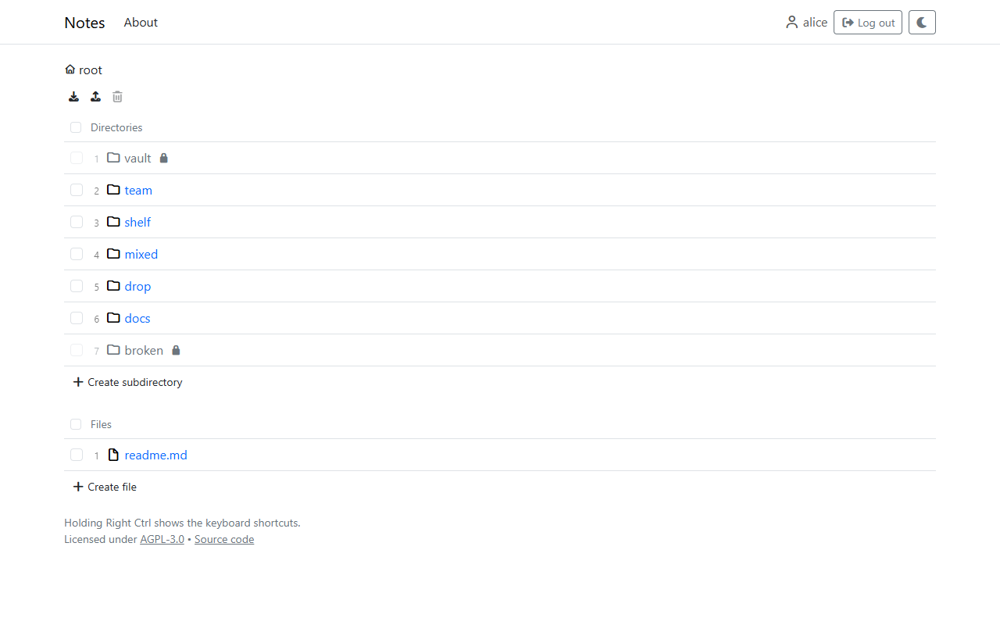

# notes

A self-hosted notes app: Markdown notes and other files in directories, edited in the browser, with permissions per directory and file. Users log in through Keycloak. It runs as a Docker Compose stack behind a Cloudflare tunnel, so the server needs no public IP and no open port.

## Quick start

1. `.env.example` is copied to `.env` and filled in.
2. `docker compose up -d --build`

The whole setup (Cloudflare tunnel, Keycloak, the first admin) is in [Deployment](docs/administration/deployment.md).

## Documentation

- [Using the app](docs/using.md): browsing, viewing and editing files, organizing them, the keyboard.
- [Administration](docs/administration.md): deployment, sessions, permissions, the kill switch.
- [Development](docs/development.md): the principles of this repository, how the app is put together, running it locally, the tests, and the security specification.

## License

[AGPL-3.0](LICENSE)
