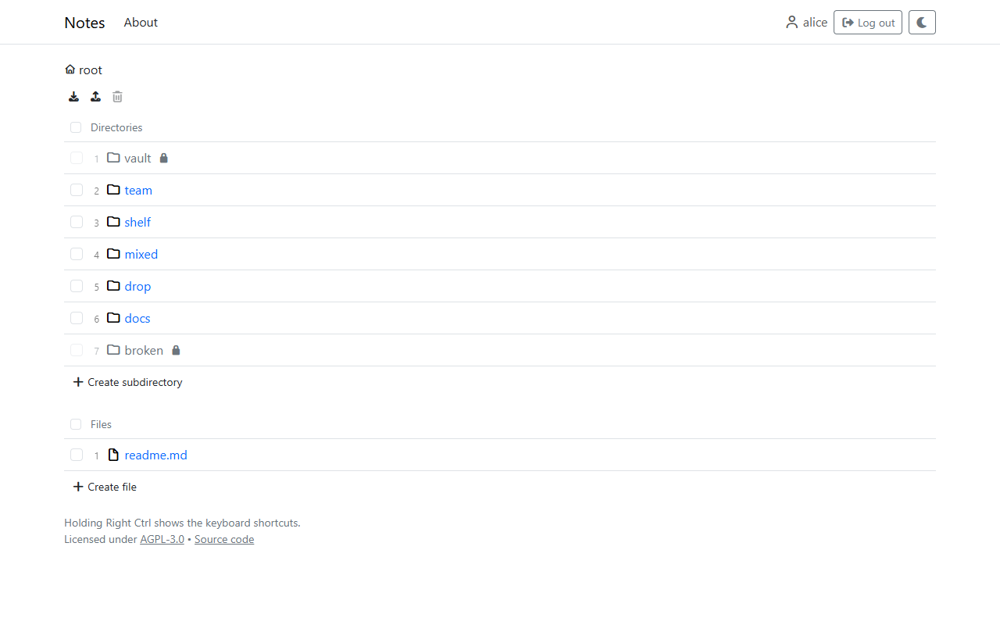

# Using the app

The app shows a folder of notes in the browser: directories and files, with Markdown files shown rendered. What each user may see and change is set per directory and file (see [Permissions](administration/permissions.md)); without logging in, only what is open to everyone can be seen.

- [Browsing](usage/browsing.md): directories, the address of everything, logging in, light and dark.
- [Viewing and editing files](usage/viewing-and-editing.md): the Markdown preview, the editors, images and other media.
- [Organizing](usage/organizing.md): creating, uploading, renaming, deleting, downloading, and copying or moving several entries at once.
- [Keyboard](usage/keyboard.md): how the shortcuts work.
