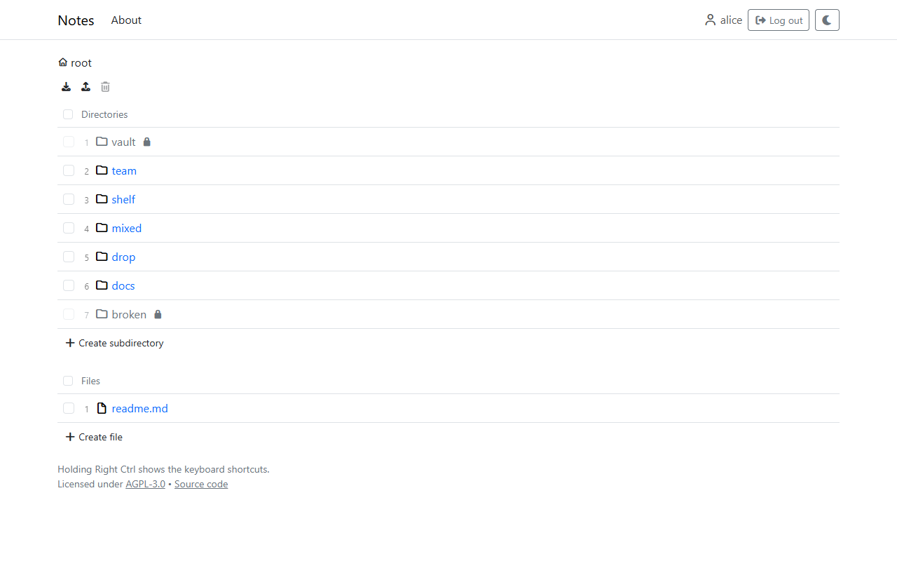
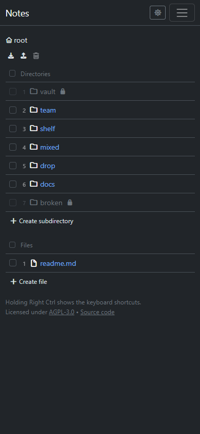
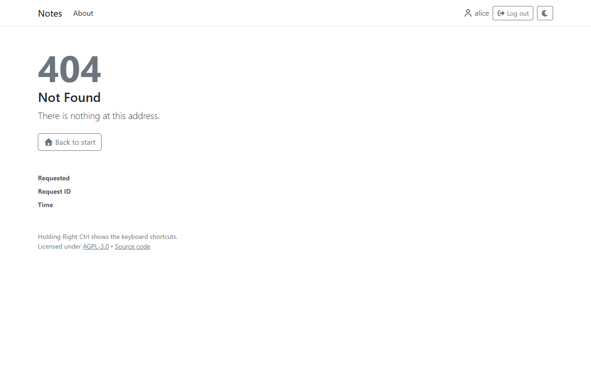
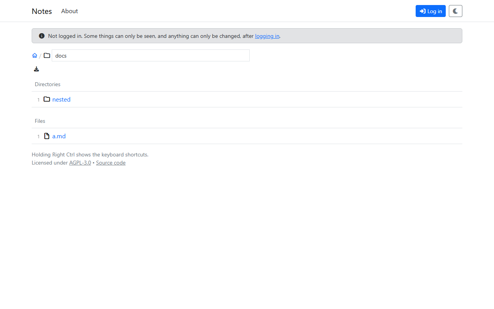

# Browsing

## Directories

A directory shows its subdirectories first, then its files, each in reverse order of their names: new entries are named after the date and time they were made (see [Organizing](organizing.md#creating)), so the newest come first. Every entry has a number, which is also its [shortcut](keyboard.md).

Above the listing is the path of the directory (the *breadcrumb*): each part of it leads to that directory, the house icon to the root. The name at its end is a text field, which renames the directory (see [Organizing](organizing.md#renaming)). Below it is the toolbar: icons for what can be done with the directory, such as downloading it. Each icon says what it does when hovered.

| Desktop, light | Phone, dark |
|---|---|
|  |  |

An entry with a lock can be seen but not opened: its name is visible, but what is in it isn't, for lack of permission. Hovering it says so.

## Addresses

Every file and directory has an address that is its path, for example `/projects/plan.md`. Such an address can be shared: whoever opens it sees the entry if they may. An address that leads nowhere, and one that leads to something the user may not know about, both show the same "not found" page.

Different views of the same file share its address and only add to it: `?edit` for the editor, `?raw` for the file itself, `?download` to download it. The pages of the app that aren't notes start with `/_/`, for example `/_/About`.

## Logging in

Without logging in, only what is open to everyone can be seen, and nothing can be changed. A note at the top of the page says so, with the link to log in.

Logging in happens on the login page of the site (Keycloak). With "Remember me" ticked there, the session lasts for days and survives closing the browser; without it, it ends with the browser or after half an hour without use (see [Sessions](../administration/sessions.md)). When a session ends while the app is open, the next page says so.

## Light and dark

The app follows the theme of the system. The button with the moon or sun at the top switches between light and dark, and the choice is kept in the browser.
