# Browsing

## Directories

A directory shows its subdirectories first, then its files, each in reverse order of their names: new entries are named after the date and time they were made (see [Organizing](organizing.md#creating)), so the newest come first. Every entry has a number, which is also its [shortcut](keyboard.md). The numbers of a group have leading zeroes up to the digits of its largest one (`01` to `12`), so that the names start at the same place.

A Markdown file is shown in the listing by its title, the text of its first `# Heading`; one without such a heading by its file name. The order and the address stay those of the file name, which hovering the title shows, and holding Right Ctrl shows in place of the titles. The breadcrumb of the file's page and earlier states always show the file name.

Images, videos and audio files are listed apart from the other files, under **Media**, as a grid of tiles in the same order: a small picture of each image, the first frame of each video (marked with a play icon), and the icon of its kind for audio. Until a picture has loaded, its tile shows the icon of its kind too, as does the breadcrumb of a media file. The grid is only there if the directory has any. Alt with the number opens one, and Alt+Shift with the number selects it; the box in the corner of a picture selects it too, and so does pressing on the tile around it. PDFs stay with the files. A picture that can't be made (a file that isn't the image its name says, or one too large) shows an icon instead.

| Desktop, light | Phone, dark |
|---|---|
| 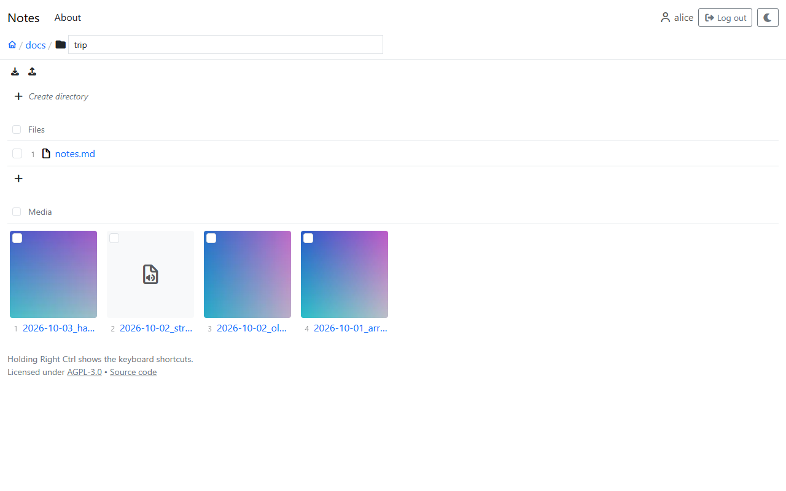 | 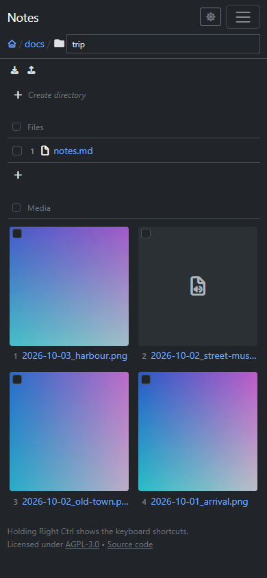 |

Above the listing is the path of the directory (the *breadcrumb*): each part of it leads to that directory, the house icon to the root. The name at its end is a text field, which renames the directory (see [Organizing](organizing.md#renaming)). The breadcrumb is always one line: where the path doesn't fit, the name at the end keeps its room, and the directories above become dots (their name shows when hovered), the outermost ones a single "…" that leads to them. Below it is the toolbar: icons for what can be done with the directory, such as downloading it. Each icon says what it does when hovered. The bar at the top and the breadcrumb below it stay at the top of the screen while the page scrolls; the toolbar scrolls with the page.

| Desktop, light | Phone, dark |
|---|---|
| 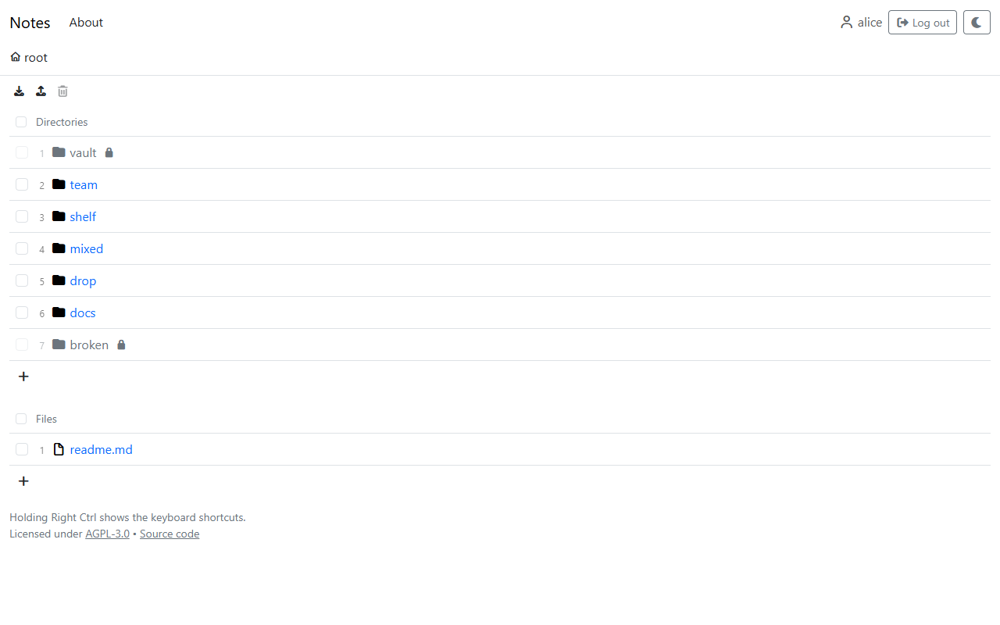 | 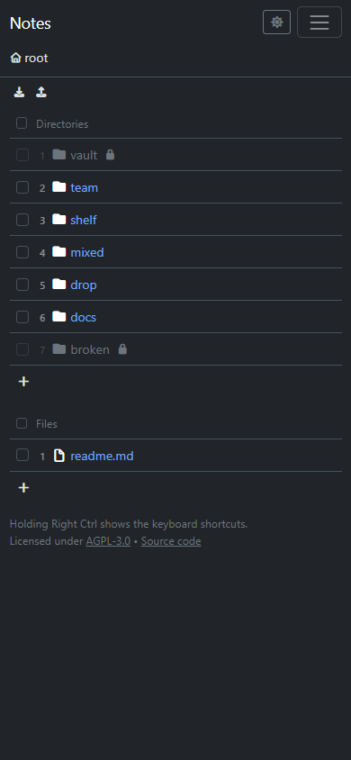 |

A directory with a zipper after its name is kept in an archive (see [Archived directories](../administration/archived-directories.md)): it is used like any other. A solid blue zipper means it is zipped now, and going into it takes a moment, which the page shows with a bar; a gray outline means it is unzipped. A bar after the outline means it is being zipped; going into it then stops that, and takes no longer than usual. An encrypted one has a shield instead: whole and yellow while it is zipped, halved and gray while it is unzipped, with a yellow bar while it is being zipped (also while its password is locked again, as the lock button zips it); its lock, if it has a password of its own, comes before it, as for any entry with a password. The zipper (or shield) is also in the breadcrumb. While one is unzipped, a gray zipper next to the account (Alt+L, when there is nothing to lock) zips them at once.

An entry with a lock can be seen but not opened: its name is visible, but what is in it isn't, for lack of permission. Hovering it says so.

## Earlier states

Where the permissions allow it, the toolbar has a calendar icon (Alt+H). It opens a dialog to choose a date and time, which lists the times at which the directory or file can be seen as it was; **View** then shows it as it was at that time, read-only, and everything reached from there stays at that time. The address says so with `?before=` and the time, and a card at the bottom of the page says which time is shown; its × (Escape) goes back to now. Files and directories that were deleted, moved or renamed since can be seen as they were too, where the permissions allow it.

| Desktop, light | Phone, dark |
|---|---|
| 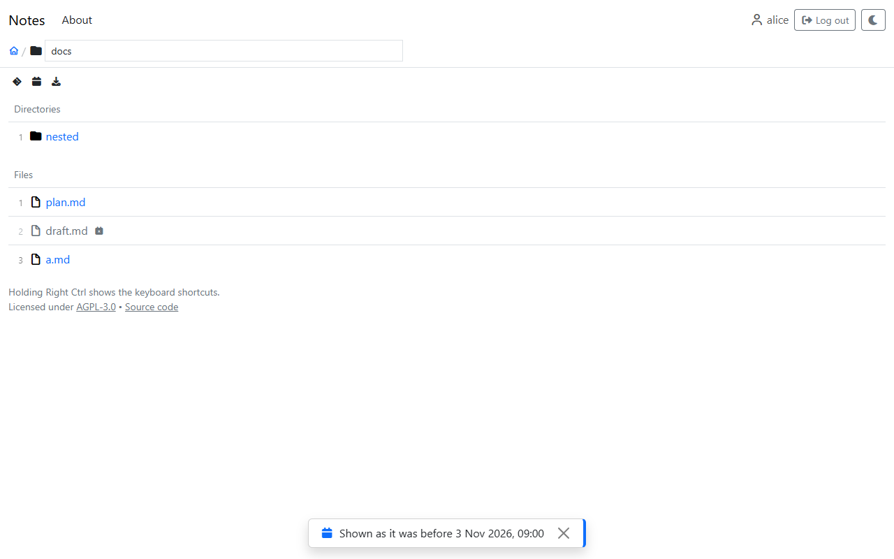 | 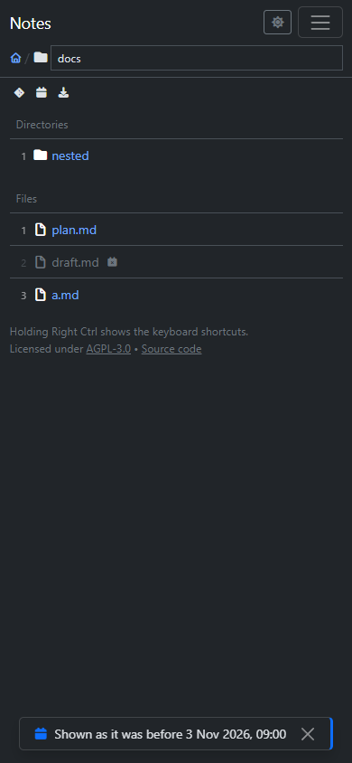 |
| 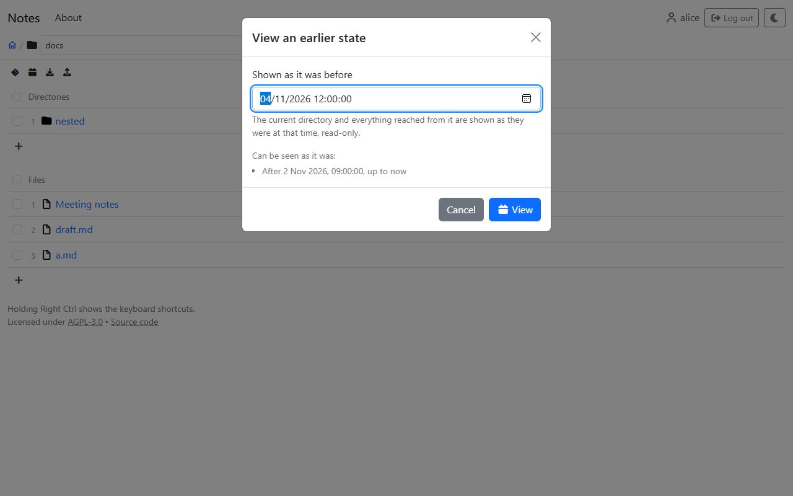 | 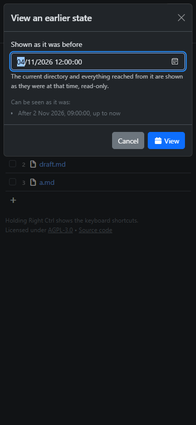 |

Left of the calendar is the git icon (H), which lists the changes of the directory or file at the left of the page (on a phone, instead of the page): the commits that changed it (or what is in it), the newest first, each with when and by whom. The arrow keys go through them (up and down) and through the pages (left and right); holding Right Ctrl shows where each one leads. Enter (or a click) shows the entry as that change left it: the address says so with `?commit=`, the card says when the change was made, why and by whom, and the list stays next to it, to go on to the next one. There H moves the focus into the list and back, and the list's × goes back to now. In an earlier state, the list starts at the state that is shown; **Show newer…** at its top adds the newer changes. Elsewhere pressing H again brings the focus back to the list, and once more hides it. Only the changes of what can be seen as it was are listed.

| Desktop, light | Phone, dark |
|---|---|
| 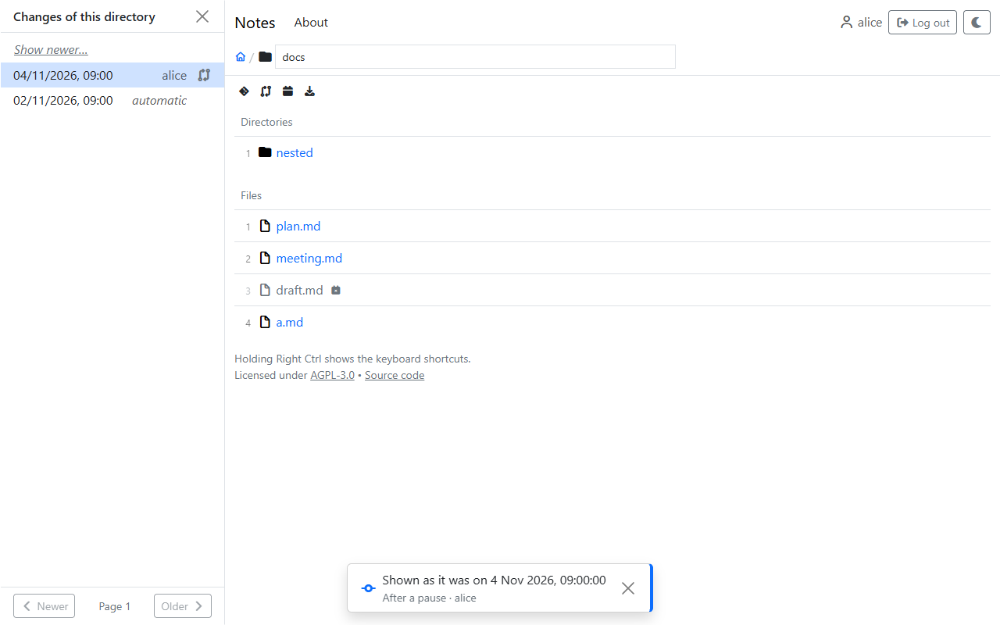 | 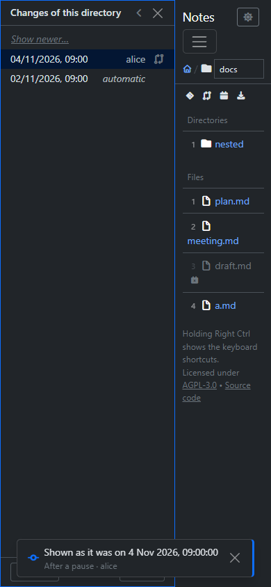 |

Next to each change in the list is the compare icon (shown on the line that is pointed at or has the focus, and on the one that is shown; Shift+Enter on a line): it shows what that change did, instead of the state it left (`&changes`, next to `?commit=`). In a directory, only what it changed is listed, marked green (added), yellow (changed) or red (deleted, struck through); a file shows what it was before next to what it became, in the code editor's diff view (inline on a phone), or, for an image or another binary file, the two next to each other. The compare icon in the toolbar (Shift+H) goes from the state a change left to what it changed, and back. As everywhere in the history, only what can be seen as it was is shown: a side of a file that can't be seen says so.

| Desktop, light | Phone, dark |
|---|---|
| 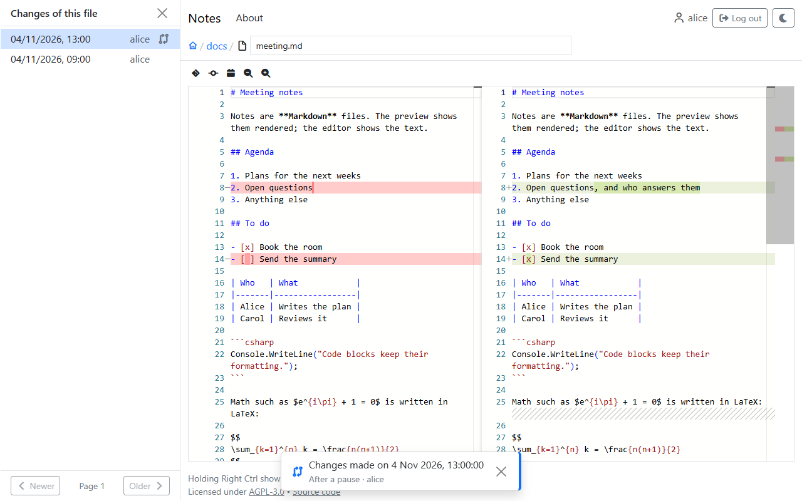 | 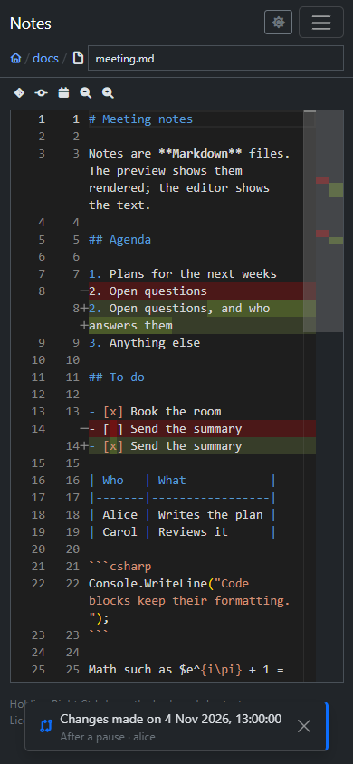 |

Whether an earlier state can be seen is up to the permissions now and at that time (see [Permissions](../administration/permissions.md#what-they-mean)). In a listing of an earlier state, an entry whose history can't be seen has a crossed-out calendar instead of the lock, and so has such a directory in the breadcrumb; an address that can't be shown goes to the entry as it is now, and says why. What the history keeps is committed every few minutes, so the latest changes may not be in it yet (see [History](../administration/history.md#when-it-commits)).

## Addresses

Every file and directory has an address that is its path, for example `/projects/plan.md`. Such an address can be shared: whoever opens it sees the entry if they may. An address that leads nowhere, and one that leads to something the user may not know about, both show the same "not found" page.

Different views of the same file share its address and only add to it: `?edit` for the editor, `?raw` for a media file on its own, `?thumbnail` for the small picture of an image, `?download` to download it. The pages of the app that aren't notes start with `/_/`, for example `/_/About`.

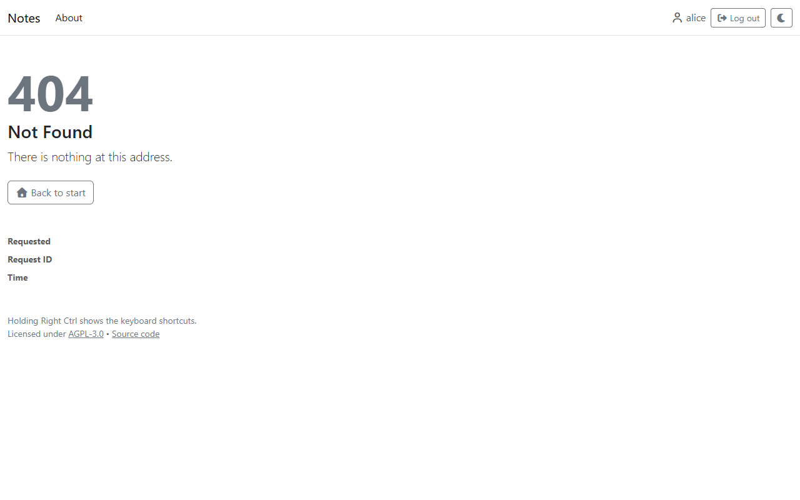

## Passwords

A directory or file can be protected by a password (see [Passwords](../administration/passwords.md)): it is listed like any other entry with a yellow lock after its name, and opening it (or anything in it) asks for the password. It then stays unlocked, with a gray unlocked padlock in its place (also in the breadcrumb, after the entry that has the password), in this browser for 10 minutes after it was last used; typing in it counts, saved or not. If it runs out while a file is being edited, saving asks for the password again and nothing typed is lost. The yellow lock next to the account (Alt+L) locks everything again at once, and goes to the folder above what was unlocked. After five wrong passwords, each further one has to wait a while, which the dialog counts down.

## Logging in

Without logging in, only what is open to everyone can be seen, and nothing can be changed. A note at the top of the page says so, with the link to log in (Alt+Shift+L; logging out has the same shortcut).

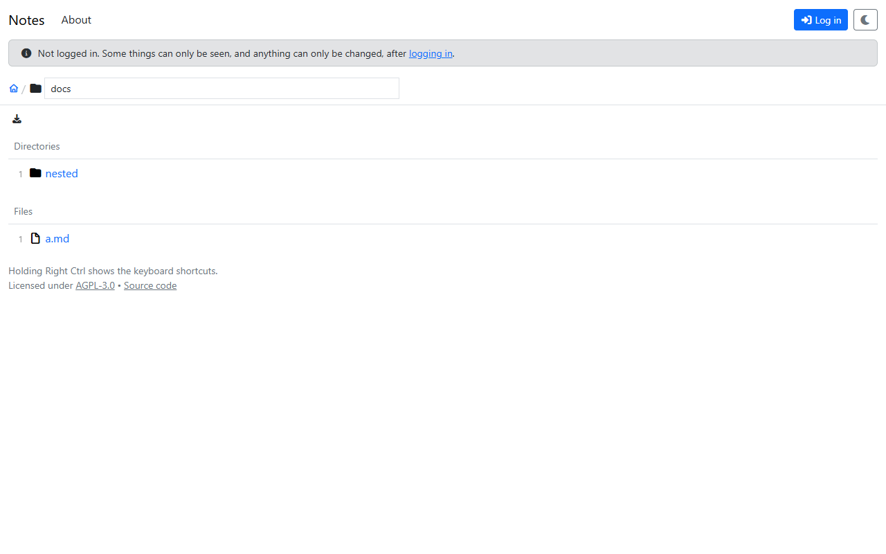

Logging in happens on the login page of the site (Keycloak). With "Remember me" ticked there, the session lasts for days and survives closing the browser; without it, it ends with the browser or after half an hour without use (see [Sessions](../administration/sessions.md)). When a session ends while the app is open, the next page says so.

## Light and dark

The app follows the theme of the system. The button with the moon or sun at the top switches between light and dark, and the choice is kept in the browser.
