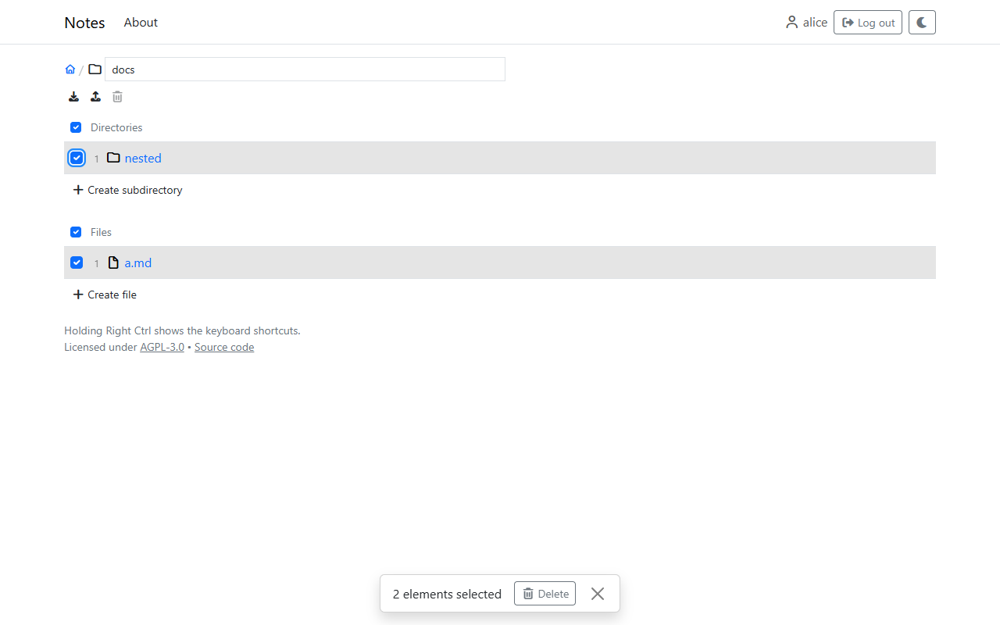
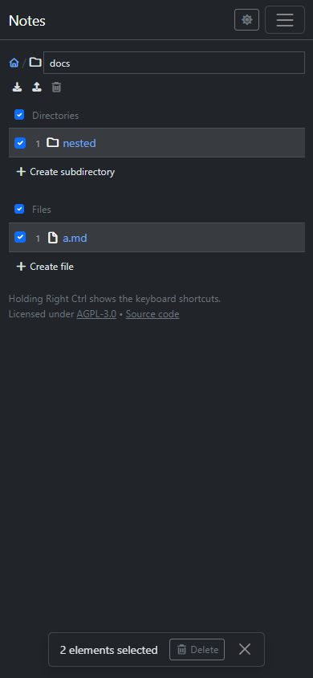
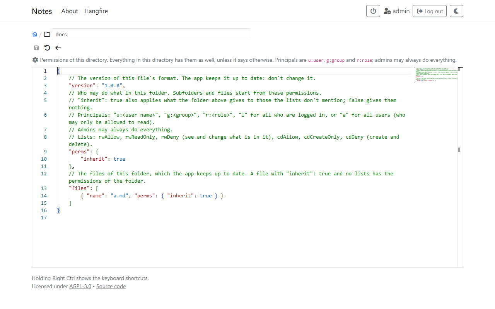

# Organizing

Everything here needs to be logged in, and permission for it (see [Permissions](../administration/permissions.md)). A control that can't be used is grayed out, and hovering it says why.

## Creating

Below the subdirectories and below the files of a directory are *Create subdirectory* (`n`) and *Create file* (Shift+N). A new entry is named after the current date and time, for example `2026-11-09_14-30` or `2026-11-09_14-30.md`; a new file opens in the editor right away. It can be renamed whenever.

## Uploading

The upload icon (or Alt+PageUp) picks files to upload into the directory, and so does dropping files onto the page. A list of the files shows first, then the progress. Files of any size can be uploaded: they are sent in parts.

If a name is taken, the uploaded file gets a number: `plan.md` becomes `plan (1).md`. If a file can't be uploaded, it stays in the list with the reason, to be tried again.

## Renaming

The name at the end of the breadcrumb is a text field (F2 goes there). A changed name is confirmed with Enter or the check mark, and reset with Escape. A file with unsaved changes has to be saved first.

## Deleting

The trash can icon (or `Delete`) deletes the current file or directory. Unless it is empty, a confirmation comes first. A directory is deleted with everything in it, and only if everything in it may be deleted; otherwise nothing is.

## Selecting, copying and moving

The boxes in front of the entries select them, also several at once:

- clicking a row anywhere but on its link, or dragging over several rows,
- Ctrl and the number of an entry (Ctrl+Shift for files),
- the box above the directories (`a`) or above the files (Shift+A) for all of them.

A card at the bottom says how many entries are selected. The selection is kept while going to other directories (for half an hour). In another directory, the card offers to copy (`v`) or move (Shift+V) the selected entries there; in their own directory, it offers to delete them. Escape clears the selection.

| Desktop | Phone |
|---|---|
|  |  |

Before anything is copied, moved or deleted, everything is checked; if something isn't allowed, nothing happens and the message says what is in the way. Copying leaves out what may not be read.

## Permissions

Admins have a gear icon (or `c`) in the toolbar, which opens the permissions of the file or directory in an editor. How they are written is in [Permissions](../administration/permissions.md).

