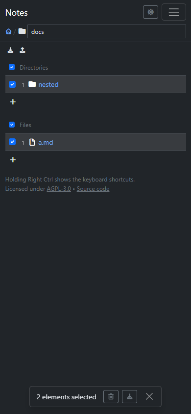

# Organizing

Everything here needs to be logged in, and permission for it (see [Permissions](../administration/permissions.md)). A control that can't be used is grayed out, and hovering it says why.

## Creating

The plus below the subdirectories creates a subdirectory (`n`), the one below the files a file (Shift+N). Where a directory has no subdirectories or no files, that group has no header, only its plus with **Create directory** or **Create file** next to it; for whoever can't create anything there, the empty group is left out. A new entry is named after the current date and time, for example `2026-11-09_14-30` or `2026-11-09_14-30.md`; a new file opens in the editor right away. It can be renamed whenever.

## Uploading

The upload icon (or Alt+PageUp) picks files to upload into the directory, and so does dropping files onto the page. A list of the files shows first; how far the upload is shows below it, and stays in view while the list scrolls. Files of any size can be uploaded: they are sent in parts. While it runs, only Cancel can be used (not Escape): it stops the upload, keeps what was uploaded and discards the file that was being sent. Closing the tab asks first.

A file that is there already, the same, is not uploaded again: each is compared with the file of its name first, piece by piece (by their SHA-256, which the browser can only make on a page served over https, or from localhost; elsewhere every file is uploaded). If a name is taken by another file (also in another case: `Plan.md` is the same name as `plan.md`), the uploaded file gets a number: `plan.md` becomes `plan (1).md`. If a file can't be uploaded, it stays in the list with the reason, to be tried again.

**An upload that didn't finish** (the tab was closed, the connection lost) is offered again on the next page that opens in this browser: Continue goes to its directory and asks for the files again, as a browser can't keep them; those that are there are skipped, and one that was half sent goes on where it stopped (if that was less than an hour ago). Discard forgets it. A file is found again by its name and size.

**Archives** (`.zip`, `.7z`) each have a box in the list, **Unzip**, ticked at first; the box above the list ticks or unticks all of them (a dash: some are). A ticked one is uploaded as a file like any other, then unzipped on the server into a new folder named after it, which takes its place: `photos.zip` becomes the folder `photos` (or `photos (1)` if that is taken). One folder around everything in it is left out: `photos.zip` holding only `photos/` becomes `photos`, not `photos/photos`. While it is unzipped, the archive has a bar after its name in the listing, and nobody has to wait for it: the page is loaded again once it is done (and says what was left out, if anything). What can't be an entry here is left out: configurations (`.config.json`), the archives of archived directories (`_.7z`, `_.zip`) and the app's data (`_`), as a download by an admin may hold them. One that can't be unzipped (encrypted, damaged, too large, a name in it that can't be one here) stays a file, with a red mark whose tooltip says why; encrypted ones are unzipped by whoever has their password, who then uploads what is in them. An unticked one stays a file. An uploaded archive is never made an archived directory: that is set up in the [configuration](../administration/archived-directories.md) afterwards. That it is to be unzipped, or why it couldn't be, is in its entry of the directory's [configuration](../administration/configuration.md), so a restart of the app loses nothing: it goes on once the directory is opened.

## Renaming

The name at the end of the breadcrumb is a text field (F2 goes there). A changed name is confirmed with Enter or the check mark, and reset with Escape; the view stays the same (a file being edited stays in the editor). A file with unsaved changes has to be saved first. While it is renamed (a directory with much in it may take a moment), the page is covered and can't be left.

## Deleting

Files and directories are deleted through the selection (see below): selected in their own directory, the card offers Delete (`Delete`), which asks for confirmation first. A directory is deleted with everything in it, and only if everything in it may be deleted; otherwise nothing is.

## Selecting, copying and moving

The boxes in front of the entries select them, also several at once:

- clicking a row anywhere but on its link, or dragging over several rows,
- Ctrl and the number of an entry (Ctrl+Shift for files),
- the box above the directories (`a`) or above the files (Shift+A) for all of them. If some of them are selected already (the box shows a dash), it unselects them instead.

A card at the bottom says how many entries are selected. The selection is kept while going to other directories (for half an hour); a directory with something selected inside it (at any depth) shows a dash in its box. As with the box above a group, using a box with a dash (or pressing on its row) unselects everything inside the directory; using it again then selects the directory. In another directory, the card offers to copy (`v`) or move (Shift+V) the selected entries there; in their own directory, it offers to delete them. Everywhere it offers to download them (Alt+Shift+PageDown): one selected file as it is, anything else as an archive, which a dialog asks how to make (see [Downloading](viewing-and-editing.md#downloading)). While a copy, move or delete runs, the card shows how far it is and the page is covered and can't be left. Escape clears the selection.

| Desktop | Phone |
|---|---|
|  |  |

**What the selected entries need first** comes first on the card, in color:

- What a password locks can be selected too (its own box, like the others). The card then says how many of them there are first ("2 password-protected elements selected (+3 others)"), and offers only **Unlock...** (one password) or **Unlock all...**, which asks for each password in turn (closing the dialog stops there); nothing else can be done with the selection until then. A copy, move or delete started some other way asks for the password first, too.
- Otherwise, archived directories that are zipped now have **Unzip** (or **Unzip all**), which unzips them right away, so that using them takes no time; the other buttons still work.
- Archived directories that are unzipped have **Zip** (or **Zip all**), and entries whose password is unlocked **Lock** (or **Lock all**).

The page is loaded again afterwards, with the selection as it was.

Before anything is copied, moved or deleted, everything is checked; if something isn't allowed, nothing happens and the message says what is in the way. Copying leaves out what may not be read. While it runs, the card shows how far it is, also in other tabs.

## Permissions

Admins have a gear icon (or `c`) in the toolbar, which opens the configuration of the file or directory (its permissions, and whether the history keeps it) in an editor. How it is written is in [Configuration](../administration/configuration.md).

