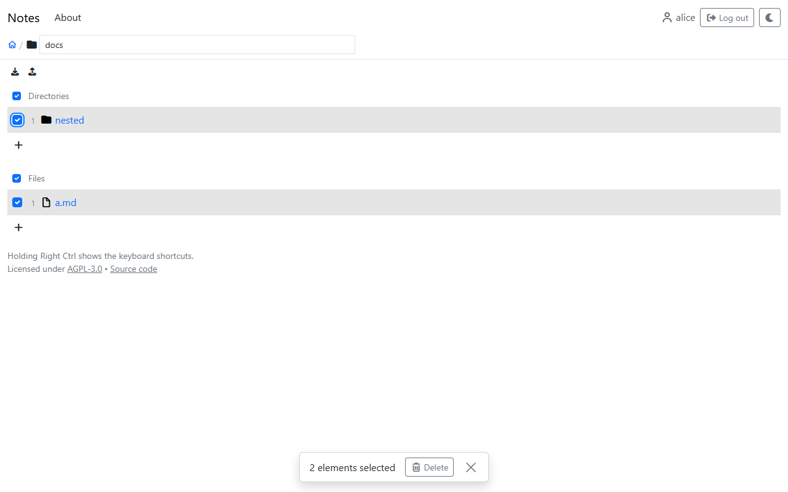
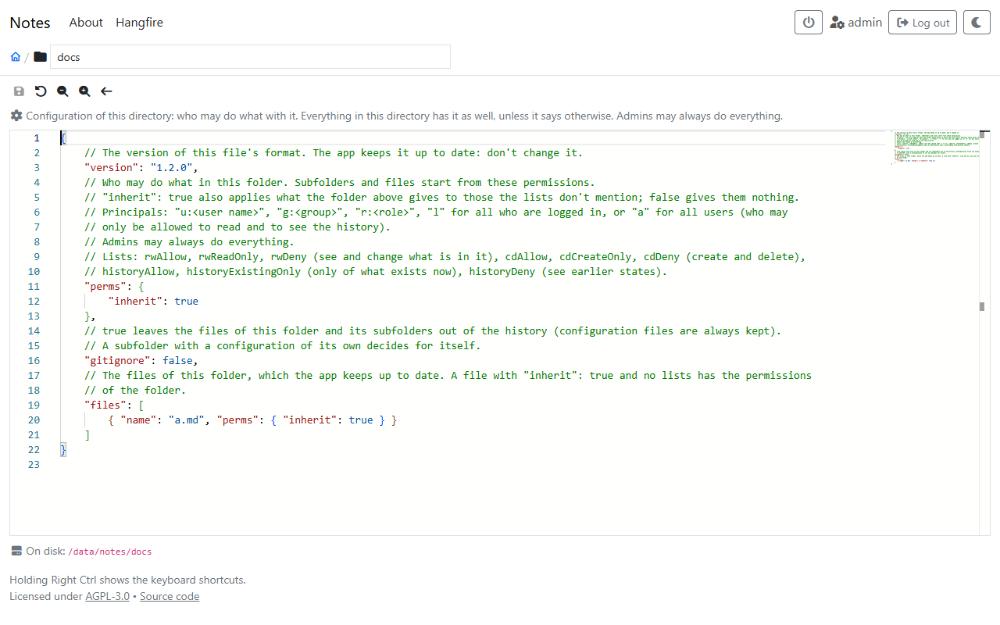

# Organizing

Everything here needs to be logged in, and permission for it (see [Permissions](../administration/permissions.md)). A control that can't be used is grayed out, and hovering it says why.

## Creating

The plus below the subdirectories creates a subdirectory (`n`), the one below the files a file (Shift+N). Where a directory has no subdirectories or no files, that group has no header, only its plus with **Create directory** or **Create file** next to it; for whoever can't create anything there, the empty group is left out. A new entry is named after the current date and time, for example `2026-11-09_14-30` or `2026-11-09_14-30.md`; a new file opens in the editor right away. It can be renamed whenever.

## Uploading

The upload icon (or Alt+PageUp) picks files to upload into the directory, and so does dropping files onto the page. A list of the files shows first, then the progress. Files of any size can be uploaded: they are sent in parts.

If a name is taken (also in another case: `Plan.md` is the same name as `plan.md`), the uploaded file gets a number: `plan.md` becomes `plan (1).md`. If a file can't be uploaded, it stays in the list with the reason, to be tried again.

## Renaming

The name at the end of the breadcrumb is a text field (F2 goes there). A changed name is confirmed with Enter or the check mark, and reset with Escape; the view stays the same (a file being edited stays in the editor). A file with unsaved changes has to be saved first. While it is renamed (a directory with much in it may take a moment), the page is covered and can't be left.

## Deleting

Files and directories are deleted through the selection (see below): selected in their own directory, the card offers Delete (`Delete`), which asks for confirmation first. A directory is deleted with everything in it, and only if everything in it may be deleted; otherwise nothing is.

## Selecting, copying and moving

The boxes in front of the entries select them, also several at once:

- clicking a row anywhere but on its link, or dragging over several rows,
- Ctrl and the number of an entry (Ctrl+Shift for files),
- the box above the directories (`a`) or above the files (Shift+A) for all of them. If some of them are selected already (the box shows a dash), it unselects them instead.

A card at the bottom says how many entries are selected. The selection is kept while going to other directories (for half an hour); a directory with something selected inside it (at any depth) shows a dash in its box. As with the box above a group, using a box with a dash (or pressing on its row) unselects everything inside the directory; using it again then selects the directory. In another directory, the card offers to copy (`v`) or move (Shift+V) the selected entries there; in their own directory, it offers to delete them. Everywhere it offers to download them (Alt+Shift+PageDown): one selected file as it is, anything else as an archive, which a dialog asks how to make (see [Downloading](viewing-and-editing.md#downloading)). While a copy, move or delete runs, the card shows how far it is and the page is covered and can't be left. Escape clears the selection.

| Desktop | Phone |
|---|---|
|  |  |

Before anything is copied, moved or deleted, everything is checked; if something isn't allowed, nothing happens and the message says what is in the way. Copying leaves out what may not be read. While it runs, the card shows how far it is, also in other tabs.

## Permissions

Admins have a gear icon (or `c`) in the toolbar, which opens the configuration of the file or directory (its permissions, and whether the history keeps it) in an editor. How it is written is in [Configuration](../administration/configuration.md).

