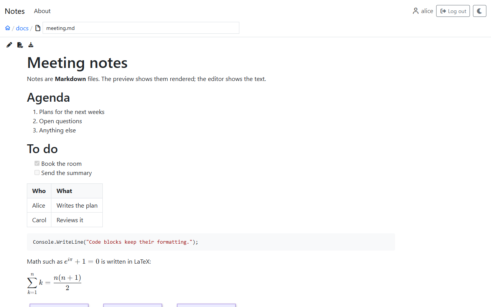
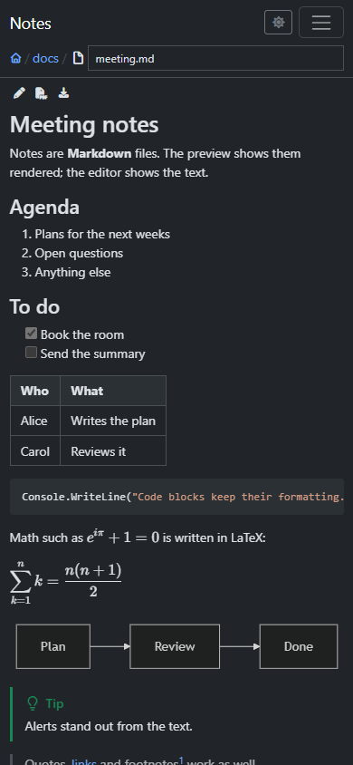
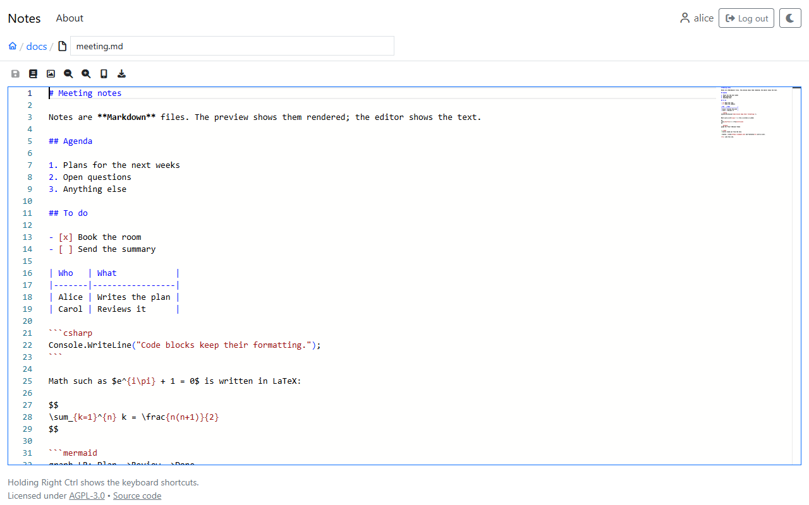
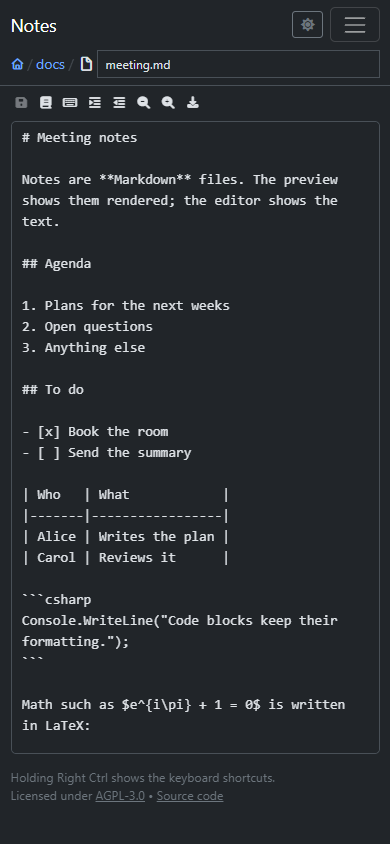
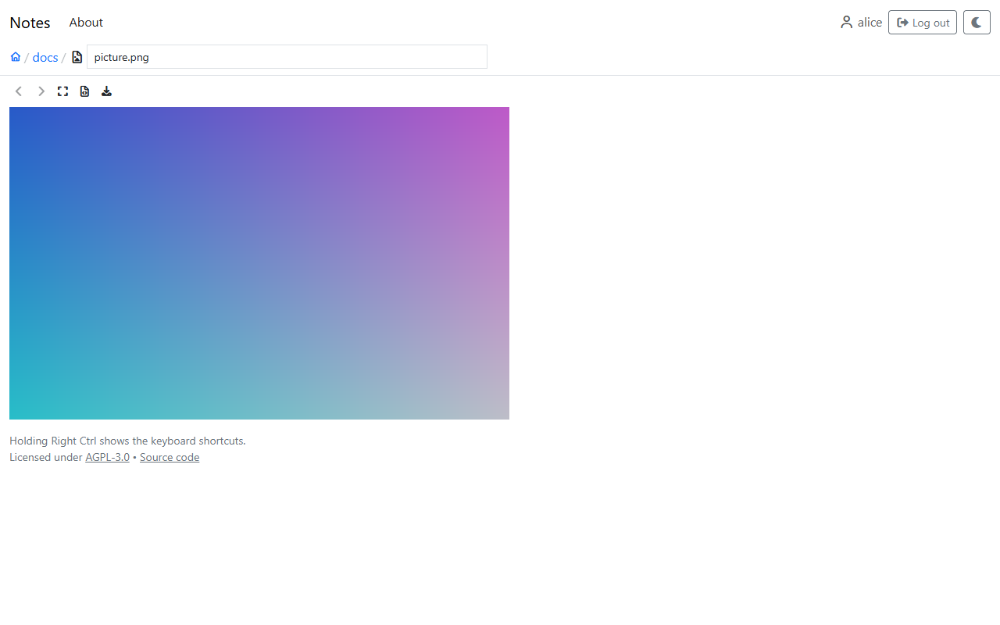

# Viewing and editing files

What a file shows depends on its kind.

## Markdown

A Markdown file (`.md`) opens rendered: headings, lists, tables, task lists, code blocks, quotes, links, images and footnotes. HTML written into a note is shown as text, never run. A line break in the text is a line break in the rendered view. A blank line between list items starts a new group of items, a small gap below the one before, instead of spreading the whole list out.

Besides what Markdown always has:

| Written as | Shows |
|---|---|
| ` ```csharp ` … ` ``` ` | Code, highlighted for its language (most common languages; others stay plain) |
| `$a^2$`, and `$$` on the lines before and after a formula | Math in LaTeX, inline or as a block of its own |
| ` ```mermaid ` … ` ``` ` | A [mermaid](https://mermaid.js.org) diagram |
| `> [!NOTE]` (also `TIP`, `IMPORTANT`, `WARNING`, `CAUTION`) at the start of a quote | An alert, colored by its kind |
| `:::warning` … `:::` | A box around what is in it; `note`, `info`, `tip`, `important`, `warning`, `caution` and `danger` are colored |
| `^^^` before an image, `^^^ Caption` after it | The image with a caption |
| `^^ Text` | A footer, in small print |
| `""Title""` | A citation |
| `*[W3C]: World Wide Web Consortium` on a line of its own | Every "W3C" in the note marked as an abbreviation; hovering, tapping or focusing it shows what it stands for |

A link to another site opens in a new tab; a link to the notes stays in the same one.

| Desktop, light | Phone, dark |
|---|---|
|  |  |

The pencil icon (or `e`) opens the editor, the book icon (or `p`) goes back to the rendered view, scrolled to the part of the text the cursor of the editor was in. Without permission to change the file, and in an earlier state of the notes (`?before=`, `?commit=`), the code icon (also `e`) takes the place of the pencil: it opens the source in the editor, read-only.

The PDF icon (or Ctrl+P) saves the rendered file as a PDF: it opens the browser's print dialog, where "Save as PDF" is chosen as the printer. The PDF has only the text, without the page around it, always in the light theme, with the name of the file and the date at the top of every page and the page number at the bottom; the browser suggests the name of the file as the name of the PDF. Browsers that can't replace their own header and footer with these (Firefox, for instance) print theirs at the edge of the paper instead; a message then says that unchecking "Print headers and footers" in the print dialog gives the best result. Math and diagrams are in it as they are shown, and its text can be selected and searched.

Pointing anywhere on the line of a part of the rendered text (a paragraph, a list item, a heading, a code block, …), tapping it, or moving the focus into it shows a small pencil to its left. It opens the editor with the cursor where that part is written, scrolled to the middle of the editor. Where the file can't be changed it is the code icon, and the editor is read-only.

On a narrow screen, such as a phone, there is no room left of the text: tapping a part of it shows the pencil over the text, right above where it was tapped, and the editor opens with the cursor at that very character. Tapping the same part again, or anywhere else, takes it away.

Holding Alt shows the pencil right where the mouse is, as long as it is over text; clicking then opens the editor with the cursor at that character. The character is found again in the text by the rendered words before it, so behind markup that shows something other than what is written (math, emoji) it may be a little off.

## The editors

Every text file can be edited in the browser. There are two editors, and the choice between them is kept in the browser:

- The **code editor** (Monaco, the editor of Visual Studio Code), with highlighting, search and everything else of a code editor.
- The **simple editor**, a plain text field, which works better on phones.

| Code editor | Simple editor, on a phone |
|---|---|
|  |  |

The phone icon in the toolbar switches to the simple editor, the keyboard icon back to the code editor. In the simple editor, as a phone has no Tab key, the two icons next to the keyboard icon (or Ctrl+] and Ctrl+[) do what Tab and Shift+Tab do in the code editor: indent the selected lines, or put an indent at the cursor, and take an indent away again; the text field keeps the focus, and with it the keyboard of a phone. In Markdown and plain text files (`.md`, `.txt`) the code editor doesn't suggest words while typing. The floppy disk icon (or Ctrl+S) saves; it is only blue while there is something to save. Leaving the page with unsaved changes asks first.

The magnifying glass icons (or Alt+Plus and Alt+Minus) make the text of the editor larger and smaller; inside the editor, Ctrl+Plus, Ctrl+Minus and Ctrl+scrolling do the same, and Ctrl+0 goes back to the usual size. Both editors share the zoom, and it is kept in the browser.

A file that may be read but not changed opens in the editor as read-only, and the Save icon says why it can't be used.

## Images, video, audio and PDF

Images, videos, audio files and PDFs are shown on the file's page by the browser. The image icon shows the file on its own, as the browser would (`?raw`).

Images that browsers can't show themselves are converted for showing: photos of phones (HEIC/HEIF) and cameras (RAW files such as CR2, NEF, ARW or DNG), JPEG XL, JPEG 2000, TIFF, Photoshop and GIMP files, and many older formats. They are shown as JPEG, or as PNG where they are transparent; only the first page or layer is shown (the merged image of a Photoshop file). Downloading them still gives the file as it is. A file that isn't the image its name says can't be shown.



Other files that aren't text can't be shown, and only be downloaded.

## Downloading

The download icon (or Alt+PageDown) downloads the file. For a directory it downloads a zip of everything in it that may be read.
