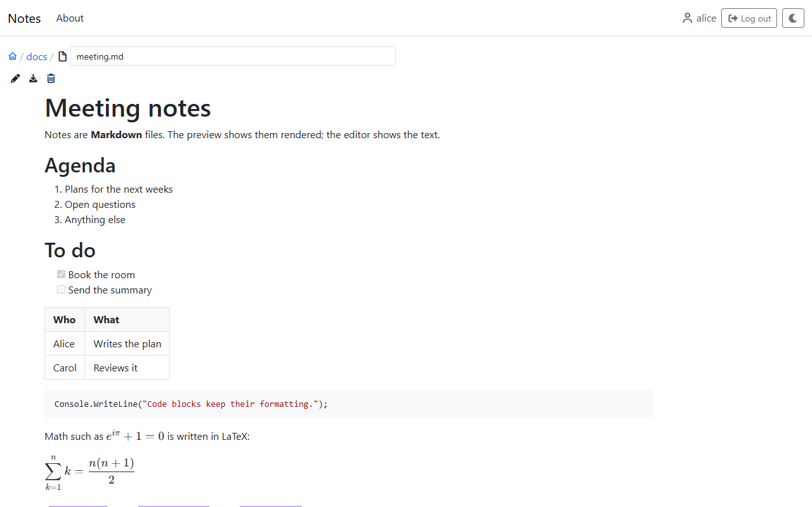
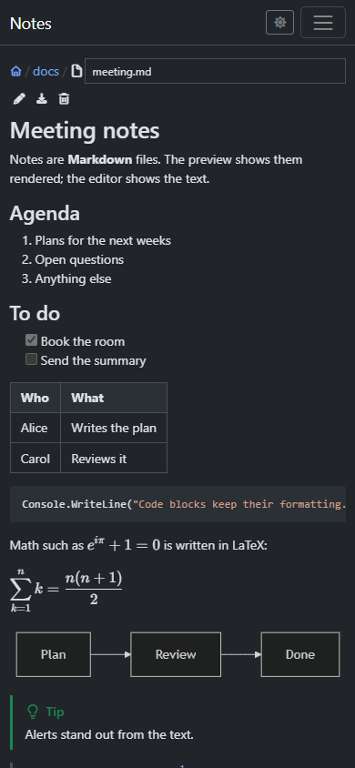
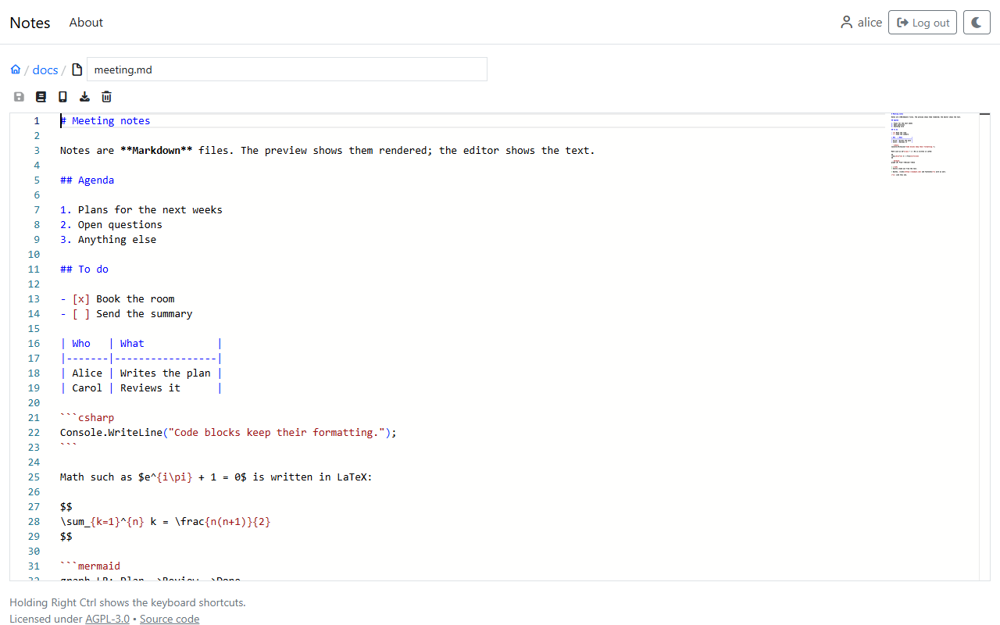
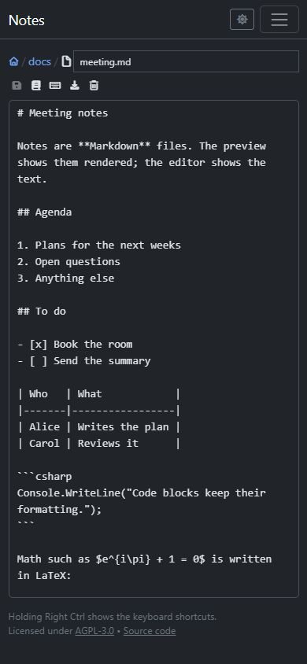
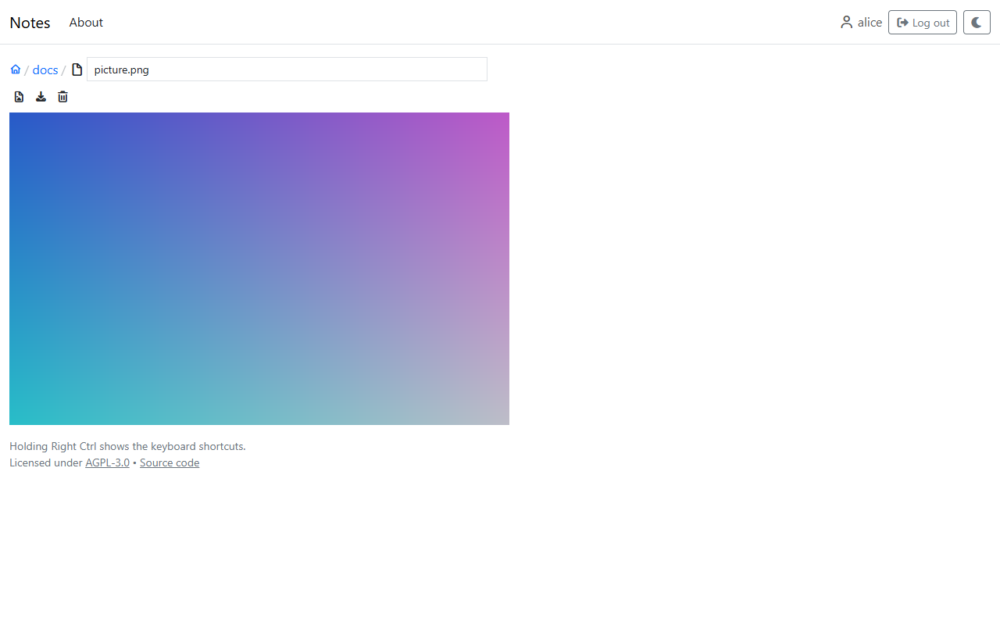

# Viewing and editing files

What a file shows depends on its kind.

## Markdown

A Markdown file (`.md`) opens rendered: headings, lists, tables, task lists, code blocks, quotes, links, images and footnotes. HTML written into a note is shown as text, never run. A line break in the text is a line break in the rendered view.

Besides what Markdown always has:

| Written as | Shows |
|---|---|
| ` ```csharp ` … ` ``` ` | Code, highlighted for its language (most common languages; others stay plain) |
| `$a^2$`, and `$$` on the lines before and after a formula | Math in LaTeX, inline or as a block of its own |
| ` ```mermaid ` … ` ``` ` | A [mermaid](https://mermaid.js.org) diagram |
| `> [!NOTE]` (also `TIP`, `IMPORTANT`, `WARNING`, `CAUTION`) at the start of a quote | An alert, colored by its kind |
| `:::warning` … `:::` | A box around what is in it; `note`, `info`, `tip`, `important`, `warning`, `caution` and `danger` are colored |
| `^^^` before an image, `^^^ Caption` after it | The image with a caption |
| `^^ Text` | A footer, in small print |
| `""Title""` | A citation |
| `*[W3C]: World Wide Web Consortium` on a line of its own | Every "W3C" in the note marked as an abbreviation; hovering, tapping or focusing it shows what it stands for |

A link to another site opens in a new tab; a link to the notes stays in the same one.

| Desktop, light | Phone, dark |
|---|---|
|  |  |

The pencil icon (or `e`) opens the editor, the book icon (or `p`) goes back to the rendered view. Without permission to change the file, there is only the rendered view.

## The editors

Every text file can be edited in the browser. There are two editors, and the choice between them is kept in the browser:

- The **code editor** (Monaco, the editor of Visual Studio Code), with highlighting, search and everything else of a code editor.
- The **simple editor**, a plain text field, which works better on phones.

| Code editor | Simple editor, on a phone |
|---|---|
|  |  |

The phone icon in the toolbar switches to the simple editor, the keyboard icon back to the code editor. The floppy disk icon (or Ctrl+S) saves; it is only blue while there is something to save. Leaving the page with unsaved changes asks first.

A file that may be read but not changed opens in the editor as read-only, and the Save icon says why it can't be used.

## Images, video, audio and PDF

Images, videos, audio files and PDFs are shown on the file's page by the browser. The image icon shows the file on its own, as the browser would (`?raw`).



Other files that aren't text can't be shown, and only be downloaded.

## Downloading

The download icon (or Alt+PageDown) downloads the file. For a directory it downloads a zip of everything in it that may be read.
