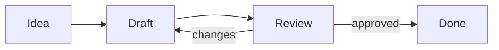
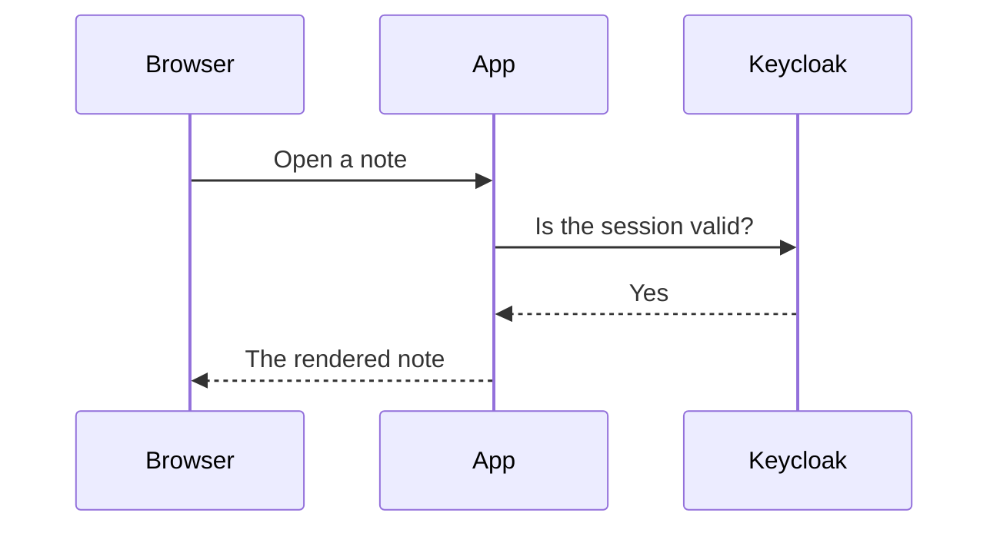
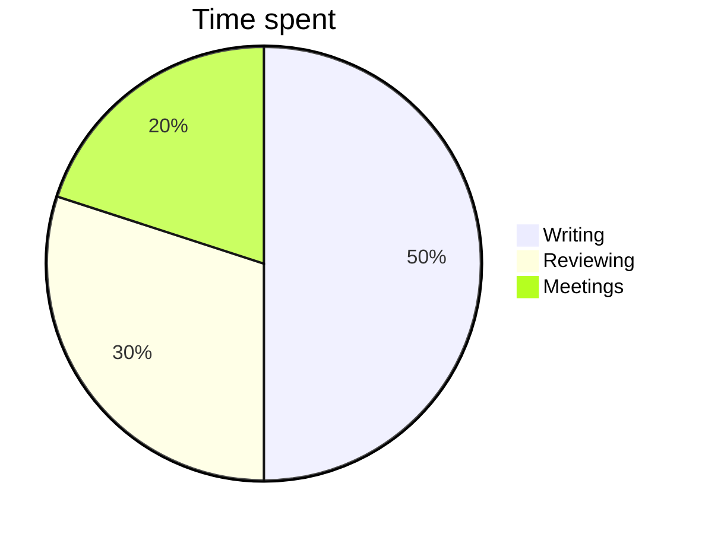
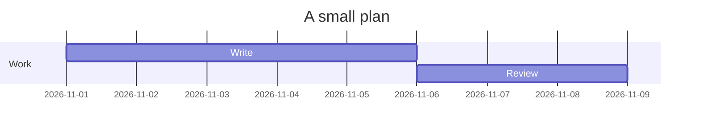

# Markdown Cheat Sheet

Thanks for visiting [The Markdown Guide](https://www.markdownguide.org)!

This Markdown cheat sheet provides a quick overview of all the Markdown syntax elements. It can’t cover every edge case, so if you need more information about any of these elements, refer to the reference guides for [basic syntax](https://www.markdownguide.org/basic-syntax/) and [extended syntax](https://www.markdownguide.org/extended-syntax/).

## Basic Syntax

These are the elements outlined in John Gruber’s original design document. All Markdown applications support these elements.

### Heading

# H1
## H2
### H3

### Bold

**bold text**

### Italic

*italicized text*

### Blockquote

> blockquote

### Ordered List

1. First item
2. Second item
3. Third item

### Unordered List

- First item
- Second item
- Third item

### Code

`code`

### Horizontal Rule

---

### Link

[Markdown Guide](https://www.markdownguide.org)

### Image


## Extended Syntax

These elements extend the basic syntax by adding additional features. Not all Markdown applications support these elements.

### Table

| Syntax | Description |
| ----------- | ----------- |
| Header | Title |
| Paragraph | Text |

### Fenced Code Block

```
{
  "firstName": "John",
  "lastName": "Smith",
  "age": 25
}
```

### Footnote

Here's a sentence with a footnote. [^1]

[^1]: This is the footnote.

### Heading ID

### My Great Heading {#custom-id}

### Definition List

term
: definition

### Strikethrough

~~The world is flat.~~

### Task List

- [x] Write the press release
- [ ] Update the website
- [ ] Contact the media

### Emoji

That is so funny! :joy:

(See also [Copying and Pasting Emoji](https://www.markdownguide.org/extended-syntax/#copying-and-pasting-emoji))

### Highlight

I need to highlight these ==very important words==.

### Subscript

H~2~O

### Superscript

X^2^

## More of This App

Everything below works in the preview of this app, on top of the syntax above.

### Line Breaks

A line break in the text
is a line break in the preview,
without two spaces or a backslash at the end.

### Inserted Text

Text that was ++inserted++ later.

### Lettered and Roman Lists

Lowercase letters:

a. First item
b. Second item
c. Third item

Roman numerals:

i. First item
ii. Second item
iii. Third item

Uppercase letters:

A. First item
B. Second item

### Automatic Links

https://www.markdownguide.org and www.markdownguide.org become links by themselves, as does <mailto:someone@example.com>.

### Links: New Tab or Not

- [A link to another site](https://www.markdownguide.org) opens in a new tab.
- [A link to a note](/hello) and [a relative one](../) stay in the same tab.
- [A link to a heading on this page](#heading-ids-and-links) jumps there.

### Images of the Notes

An image in the notes is written with its path, like any link: `` or ``.

### Heading IDs and Links

Every heading gets an ID from its text, so `[jump](#line-breaks)` leads to [the section about line breaks](#line-breaks). An ID of its own is set with `{#my-id}` after the heading.

### Abbreviations

The HTML specification is maintained by the W3C.

*[HTML]: Hyper Text Markup Language
*[W3C]: World Wide Web Consortium

Hovering or tapping an abbreviation shows what it stands for. It applies everywhere in the note, the heading at the end included.

### Citations

""The Markdown Guide"" is a reference for all of this.

### Figures

^^^

^^^ Tux, the Linux mascot, with a caption below.

### Footers

^^ A footer, in small print, for example the source of what is above.

### Grid Tables

+-----------+-----------------------------+
| Syntax    | Description                 |
+===========+=============================+
| Header    | A cell can hold             |
|           |                             |
|           | - a list                    |
|           | - or several paragraphs     |
+-----------+-----------------------------+
| Paragraph | Text                        |
+-----------+-----------------------------+

### Table Alignment

| Left | Center | Right |
| :--- | :----: | ----: |
| a    | b      | c     |
| aaa  | bbb    | ccc   |

### Highlighted Code

A fenced code block with a language is highlighted:

```csharp
// C#, also written as cs
public record Person(string Name, int Age)
{
    public bool IsAdult => Age >= 18;
}
```

```js
// JavaScript, also written as javascript
const greet = name => `Hello, ${name}!`;
console.log(greet('world'));
```

```python
# Python, also written as py
def fibonacci(n):
    return n if n < 2 else fibonacci(n - 1) + fibonacci(n - 2)
```

```json
{
  "firstName": "John",
  "age": 25,
  "admin": false
}
```

```sql
SELECT name, COUNT(*) AS notes
FROM users
WHERE active = 1
GROUP BY name;
```

Also known: `html`, `xml`, `css`, `typescript` (`ts`), `cpp` (`c`), `java`, `php`, `powershell`, `vb.net`, `f#`, `haskell`, `markdown`, `matlab`, `fortran`, `koka`. Any other language stays plain.

### Math

Inline math goes between single dollar signs: $E = mc^2$, $a^2 + b^2 = c^2$, $\sqrt{2} \approx 1.414$.

A block of math goes between double dollar signs, on lines of their own:

$$
\int_0^\infty e^{-x^2} \, dx = \frac{\sqrt{\pi}}{2}
$$

$$
\begin{pmatrix} a & b \\ c & d \end{pmatrix}
\begin{pmatrix} x \\ y \end{pmatrix}
=
\begin{pmatrix} ax + by \\ cx + dy \end{pmatrix}
$$

$$
f(x) = \begin{cases} x^2 & \text{if } x \ge 0 \\ -x & \text{otherwise} \end{cases}
$$

A formula with a mistake shows the mistake in red instead: $\frac{1}{$

### Diagrams

A code block with the language `mermaid` is drawn as a [mermaid](https://mermaid.js.org) diagram.









A diagram with a mistake shows its text and why it couldn't be drawn:

```mermaid
flowchart LR
    this is not --> valid -->
```

### Alerts

> [!NOTE]
> Useful information that should be noticed even when skimming.

> [!TIP]
> Helpful advice for doing things better or more easily.

> [!IMPORTANT]
> Key information needed to achieve a goal.

> [!WARNING]
> Urgent information that needs immediate attention to avoid problems.

> [!CAUTION]
> Advises about risks or negative outcomes of certain actions.

### Custom Containers

:::note
A box named `note` (or `info`), with **any** Markdown inside.
:::

:::tip
A box named `tip`.
:::

:::important
A box named `important`.
:::

:::warning
A box named `warning`.
:::

:::caution
A box named `caution` (or `danger`).
:::

:::anything
A box with any other name is gray.
:::

### HTML

HTML is shown as text, never run: <b>not bold</b> <script>alert(1)</script>